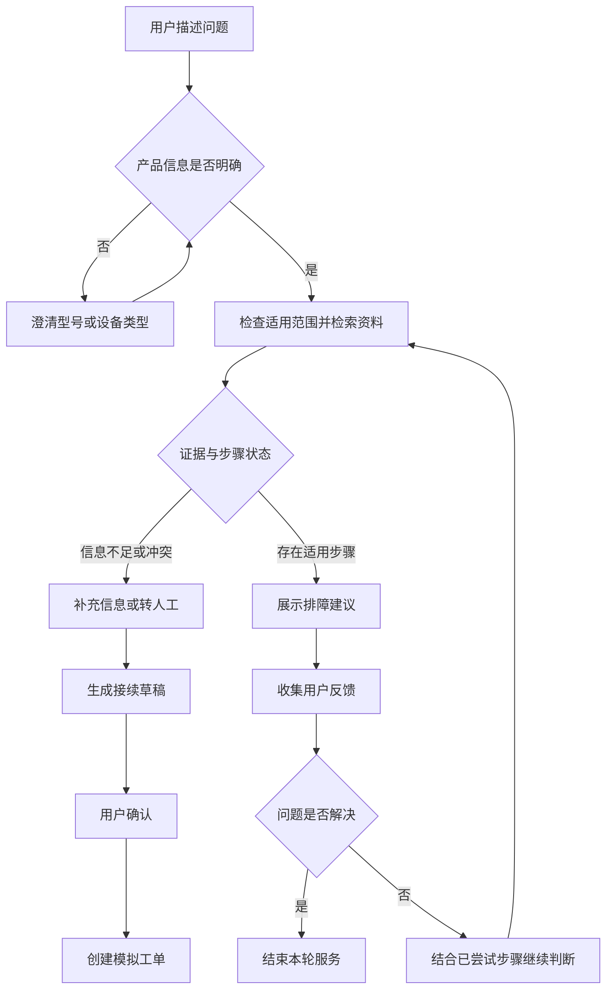

# 知维 Evidence Support Agent

面向多产品售后场景的客服 Agent，通过产品消歧、适用范围过滤与证据检索，支持多轮排障和人工接续。

项目采用 FastAPI、React、PostgreSQL / pgvector 和 Redis 构建。运行时 Python 包名为 `kefu`。

以 Anker / eufy 等产品资料作为演示场景，不是品牌官方客服服务。订单、工单及部分业务规则为明确标注的模拟数据。

## 为什么做这个项目

售后问题通常不只是“检索一段文字并回答”：

- 用户可能只提供简称，同名产品却属于不同设备类型。
- 检索结果在语义上相似，却不适用于当前型号或条件。
- 用户已经尝试过某个步骤，系统仍重复推荐。
- 技术资料不足时，模型可能给出没有依据的处理建议。
- 转人工后，用户需要再次描述问题和排障过程。

项目将“确认产品、查找适用证据、执行排障和人工接续”组织成受业务状态与确认规则约束的 Agent 流程。

## 核心设计

### 先确认产品，再检索资料

结合用户输入和已确认的订单产品信息解析设备。

对于同名产品、信息缺失或上下文冲突，先请求澄清，避免把不同设备的资料混用。

例如，用户只说“S1 Pro 不吸了”，系统需要区分扫地机器人与穿戴式吸奶器，而不能直接套用某一类产品的排障步骤。

### 检索相关且适用的证据

根据已知产品与资料元数据检查适用范围，并组合多个检索信号：

- 错误码与关键词。
- 标题与正文匹配。
- 可选的 Qwen Embedding 向量检索。
- RRF 排名融合。
- 弱匹配过滤与向量证据门槛。

产品、地区、固件等限制仅在存在对应元数据时生效。未启用 Embedding 时使用词法检索，不将其表述为已经启用向量检索。

系统区分检索成功、信息不足、未找到和资料冲突等状态；检索相关性不等同于证据足以支持完整回答。

### 根据反馈推进排障

将产品确认、可执行步骤和用户反馈纳入业务状态。

程序检查工具执行前提，模型结合当前状态与证据选择后续动作，避免仅依赖提示词维持业务规则。

可执行建议限定于已审核且满足前提条件的步骤。资料不足或冲突时，不直接把检索片段转化为操作指令。

### 让人工接续保留上下文

根据用户意图和情绪调整表达与追问方式，技术结论仍以检索证据为依据。

转人工前汇总：

- 已确认的产品与问题。
- 已尝试的排障步骤。
- 用户反馈。
- 待补充的材料。

生成接续草稿，经用户确认后创建模拟工单，减少重复沟通。

## 业务流程



## 快速开始

### 1. 准备环境

- Python 3.12+
- uv
- Node.js 22+
- 已启动的 Docker Desktop 或 Docker Engine

以下命令在仓库根目录执行。

### 2. 启动离线演示

```powershell
uv sync --frozen
uv run --frozen python scripts/demo.py start --model demo
```

浏览器访问：

```text
http://localhost:8020
```

启动器负责准备本地演示所需的数据库、Redis、迁移、前端及服务进程。

`demo` 使用模拟模型，不需要真实大模型服务；首次安装依赖、拉取镜像和构建前端仍需要网络。

本机演示凭证保存在被 Git 忽略的 `.runtime/contest/` 中。

### 3. 查看状态与停止

```powershell
uv run --frozen python scripts/demo.py status
uv run --frozen python scripts/demo.py stop
```

停止演示保留已有演示数据。

### 4. 使用真实本地模型

先启动 Ollama，并确认模型已经安装：

```powershell
ollama list
```

例如，本机已部署 `qwen3.5:4b` 时：

```powershell
uv run --frozen python scripts/demo.py stop
uv run --frozen python scripts/demo.py start --model qwen3.5:4b
```

也可以将模型名替换为已经部署的 `qwen3.5:9b`。

向量检索需要另外配置 Embedding 服务。更换对话模型不会自动启用向量检索，具体变量见 [.env.example](.env.example)。

## 建议演示路径

1. 新建任务，输入“S1 Pro 不吸了，明天派对要用”。
2. 观察系统是否先确认具体产品。
3. 确认扫地机器人 T2080，查看适用的排障建议。
4. 反馈“已尝试，无变化”，检查系统如何处理已执行步骤。
5. 查看接续草稿中的排障记录、反馈与待补材料。
6. 确认草稿，创建模拟工单。
7. 另建任务选择 T8D04，检查是否避免复用扫地机器人的步骤。

模拟模型用于展示流程；真实模型的决策表现需要单独评测。

## 评测结果

### 产品范围过滤消融

在 22 条合成作用域正例上，使用相同 RRF 检索配置与公开用户 / 订单产品信息，对比关闭和开启产品过滤：

| 指标 | 无产品过滤 | 有产品过滤 |
|---|---:|---:|
| 跨产品证据占比 | 70 / 110，63.64% | 0 / 71，0% |
| Hit@1 | 13 / 22，59.09% | 18 / 22，81.82% |

跨产品证据占比的分母是实际返回的证据数量，Hit@1 的分母是问题数量。

结果说明产品过滤在该测试集上减少了不适用证据，不代表真实客户问题解决率，也不衡量模型自动识别产品的准确率。

### 检索基线与评测口径

完整开发项目另有基于 Haystack 的 BM25、向量检索、RRF 和 Cross Encoder 离线对照实验。

评测分别关注：

- Hit@k：是否至少命中一个相关片段。
- Recall@k：标注相关片段被召回的比例。
- MRR：首个相关片段的排名。
- 无答案问题不返回证据的比例。
- 跨产品证据与适用范围违规情况。

不同策略存在召回与拦截之间的取舍，不能仅凭单项指标宣称整体更优。

数据为项目合成，尚未经过独立人工复核。离线重排及证据充分性实验不等于默认线上链路。

详见 [评测说明](docs/EVALUATION.md)。

当前最小运行仓库不包含完整离线评测数据与全部逐例产物，不能仅凭本仓库一键复现所有历史指标。

## 技术组成与源码

| 模块 | 主要技术 / 位置 |
|---|---|
| Web API | FastAPI，`src/kefu/` |
| Agent 循环 | `src/kefu/runtime/` |
| 知识检索 | `src/kefu/plugins/knowledge.py` |
| 业务工具 | `src/kefu/services.py`、`src/kefu/plugins/tools.py` |
| 状态与数据 | PostgreSQL、SQLAlchemy、Alembic |
| 向量存储 | pgvector |
| 后台任务 | Redis、Worker |
| 前端 | React、TypeScript、Vite，`web/` |
| 流程指导 | `skills/` |
| 资料与来源 | `data/` |

Haystack 主要用于独立基线实验，默认运行链路使用项目自身的知识检索插件。

## 基础检查

```powershell
uv run --frozen python -m unittest discover -s tests -v

npm --prefix web ci
npm --prefix web run build
```

最小包测试检查模块、知识导入、产品消歧和检索边界，不替代真实模型及数据库的完整集成测试。

打包验证记录见 [PACKAGE_VALIDATION.json](PACKAGE_VALIDATION.json)。

## 数据与使用边界

- 本项目用于本地演示与工程研究，不是品牌官方售后系统。
- 订单、工单和演示业务规则不代表真实服务承诺。
- 资料保留来源记录；虚构设备与模拟资料单独标注。
- 源码包不包含真实客户数据、密钥、模型权重或用户上传内容。
- 检索命中不保证回答正确，资料不足时仍需澄清或人工介入。
- 第三方数据与依赖说明见 [THIRD_PARTY.md](docs/THIRD_PARTY.md)。
